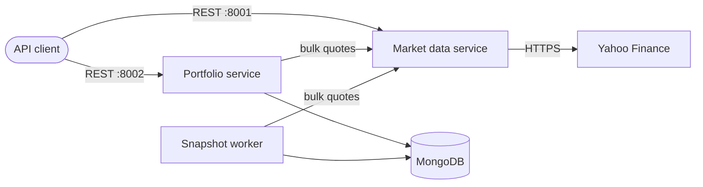

# Stocks Portfolio App

[](https://github.com/DanLilian/stocks-portfolio-app/actions/workflows/ci.yml)

A backend for managing stock portfolios and valuing them against live market data, built as Python microservices.

## Architecture



| Component | Responsibility |
| --- | --- |
| **Market data service** | Wraps the external price feed. Validates symbols, caches quotes in memory, and fetches bulk requests concurrently. |
| **Portfolio service** | Owns portfolios and holdings in MongoDB and calculates live valuations. It reaches market data only through its REST API. |
| **Snapshot worker** | Uses the portfolio service's image to record every portfolio's value on a schedule, which builds its history. |

### Design decisions

- **Provider abstraction.** Market data sits behind a small `QuoteProvider` interface. `yahoo` serves live prices, and `static` serves fixed prices so CI doesn't depend on an external API.
- **Stale data over no data.** Quotes are cached for 30 seconds by default. If the provider then fails, the last known price is returned with `"stale": true`.
- **Partial results.** One delisted symbol doesn't fail a whole valuation. The response has `"status": "partial"` and lists the symbol under `unpriced`.
- **Totals per currency.** There is no FX conversion, so totals are reported per currency instead of adding USD to GBP.
- **Safe concurrent writes.** Holding changes are compare-and-swap operations on a version field, so simultaneous trades can't overwrite each other.

## Getting started

You need Docker. To start the full stack with live prices:

```bash
docker compose up --build
```

Then create a portfolio, buy some shares and value them:

```bash
curl -X POST localhost:8002/api/v1/portfolios \
  -H "Content-Type: application/json" -d '{"name": "Growth"}'

# Use the "id" from the response
curl -X POST localhost:8002/api/v1/portfolios/<id>/holdings \
  -H "Content-Type: application/json" -d '{"symbol": "AAPL", "quantity": 10, "price": 150}'

curl localhost:8002/api/v1/portfolios/<id>/valuation
```

To run without network access, set `MARKET_DATA_PROVIDER=static`. See [.env.example](.env.example) for all settings.

## API

All errors use the same format: `{"error": {"code": "...", "message": "..."}}`.

### Market data service (port 8001)

| Method | Path | Description |
| --- | --- | --- |
| GET | `/health` | Health check |
| GET | `/api/v1/quotes/{symbol}` | Latest quote for one symbol |
| GET | `/api/v1/quotes?symbols=AAPL,MSFT` | Up to 50 quotes, with errors reported per symbol |

### Portfolio service (port 8002)

| Method | Path | Description |
| --- | --- | --- |
| GET | `/health` | Health check, including the database connection |
| POST | `/api/v1/portfolios` | Create a portfolio |
| GET | `/api/v1/portfolios` | List portfolios |
| GET | `/api/v1/portfolios/{id}` | Get a portfolio and its holdings |
| PATCH | `/api/v1/portfolios/{id}` | Update the name or description |
| DELETE | `/api/v1/portfolios/{id}` | Delete a portfolio and its history |
| POST | `/api/v1/portfolios/{id}/holdings` | Buy shares, updating the weighted average cost |
| POST | `/api/v1/portfolios/{id}/holdings/{symbol}/sell` | Sell some or all of a holding |
| PUT | `/api/v1/portfolios/{id}/holdings/{symbol}` | Correct a holding's quantity and average cost |
| DELETE | `/api/v1/portfolios/{id}/holdings/{symbol}` | Remove a holding |
| GET | `/api/v1/portfolios/{id}/valuation` | Live value, profit and loss, and day change |
| GET | `/api/v1/portfolios/{id}/history?limit=100` | Recorded valuations, newest first |

## Development

Each service has its own dependencies and tests:

```bash
cd services/portfolio
python -m venv .venv
source .venv/bin/activate
pip install -r requirements-dev.txt
pytest --cov=portfolio_service
```

Lint from the repository root with `ruff check .` and `ruff format .`.

To run the end-to-end test, start the stack with static prices and run the script:

```bash
MARKET_DATA_PROVIDER=static SNAPSHOT_INTERVAL_SECONDS=5 docker compose up --build --detach
python scripts/smoke_test.py
```

## CI/CD

[GitHub Actions](.github/workflows/ci.yml) runs on every push and pull request:

1. **Lint:** Ruff linting, including security rules, and a formatting check.
2. **Test:** each service's unit tests, with a minimum of 85% coverage.
3. **End-to-end:** builds the images, starts the stack with Docker Compose and runs the smoke test.
4. **Publish:** on `main`, pushes both images to GitHub Container Registry.

## Limitations

- **No authentication:** the API has no users or access control, so don't expose it publicly as is.
- **Unofficial price feed:** Yahoo's chart endpoint isn't a supported public API and can rate-limit or change. A production deployment should add a licensed provider through `QuoteProvider`.
- **Per-process cache:** each Gunicorn worker keeps its own quote cache. A shared cache such as Redis would be the next step.
- **Floating-point money:** amounts are floats rounded for display, which suits tracking but not accounting.
